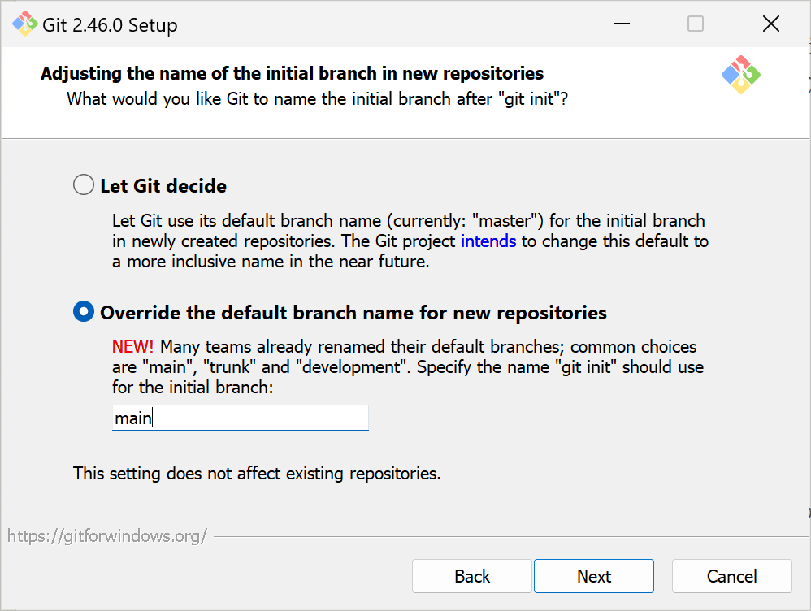
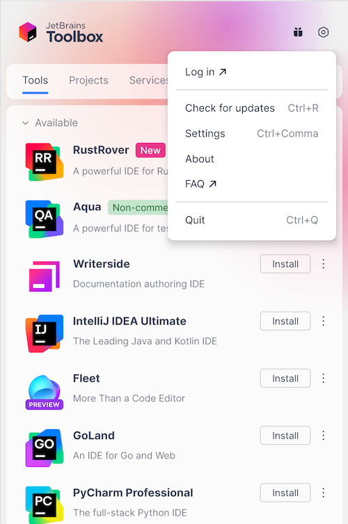
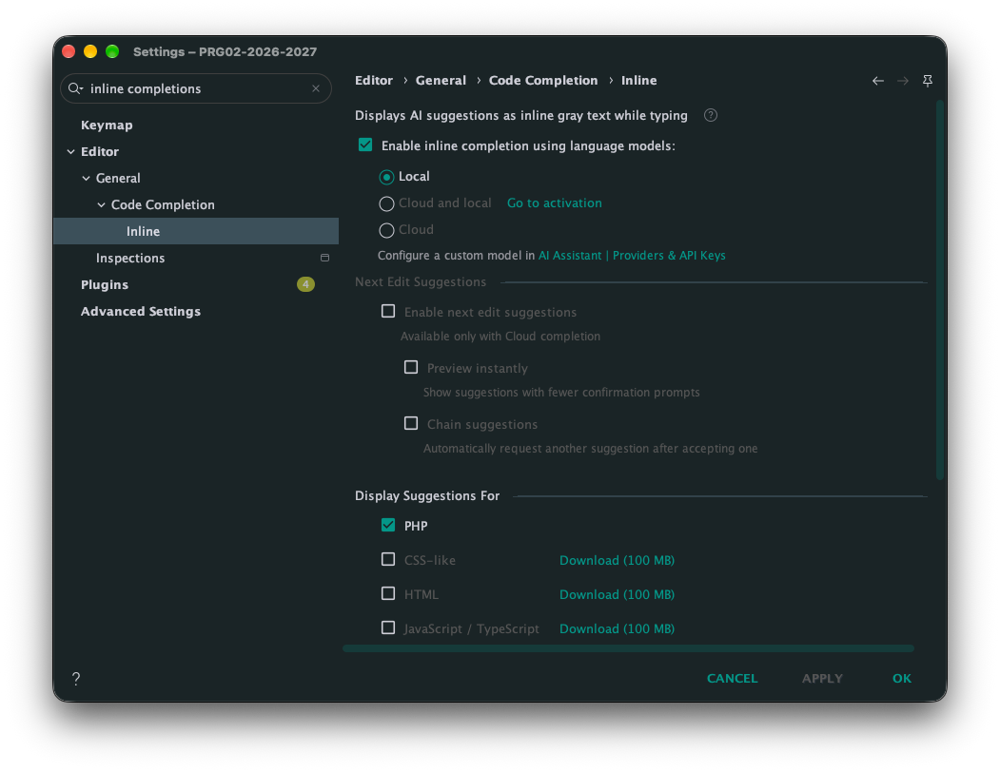
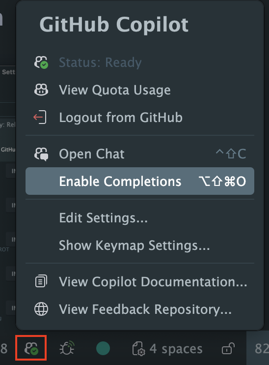
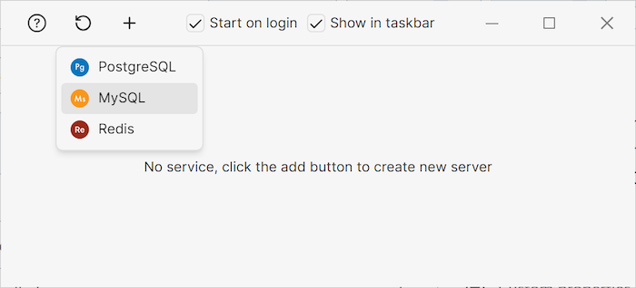
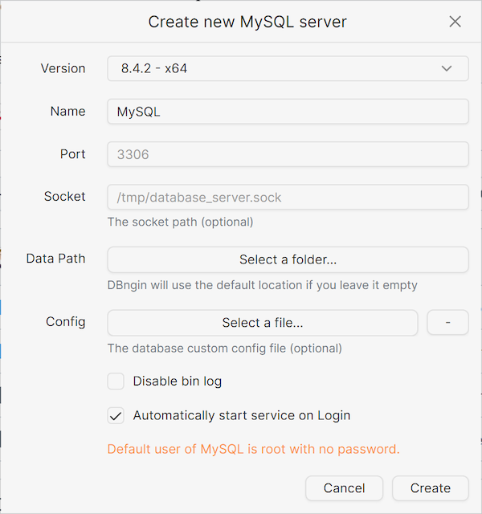
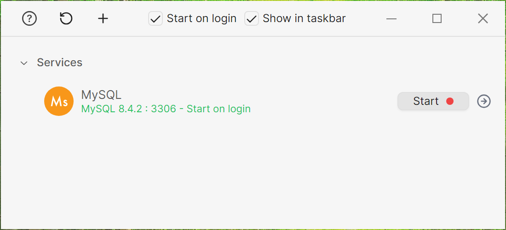
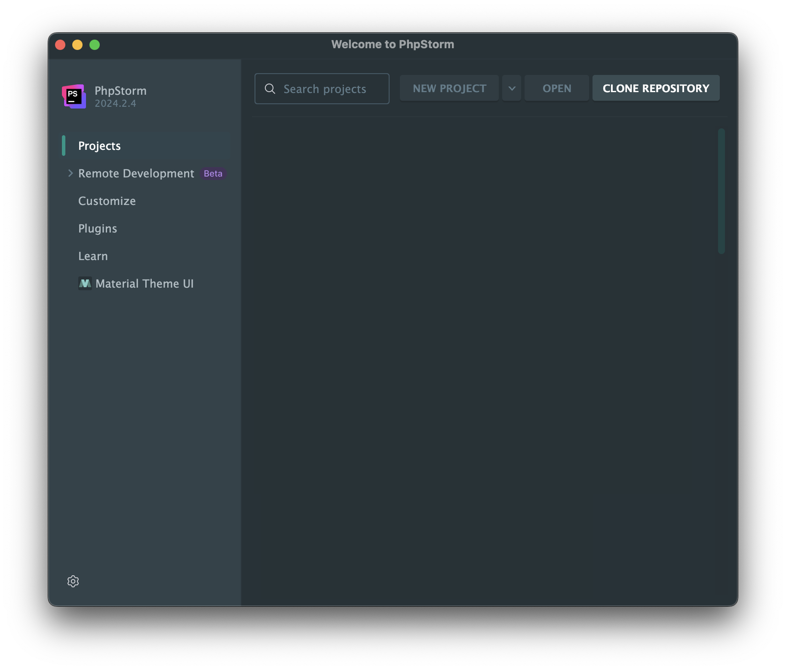
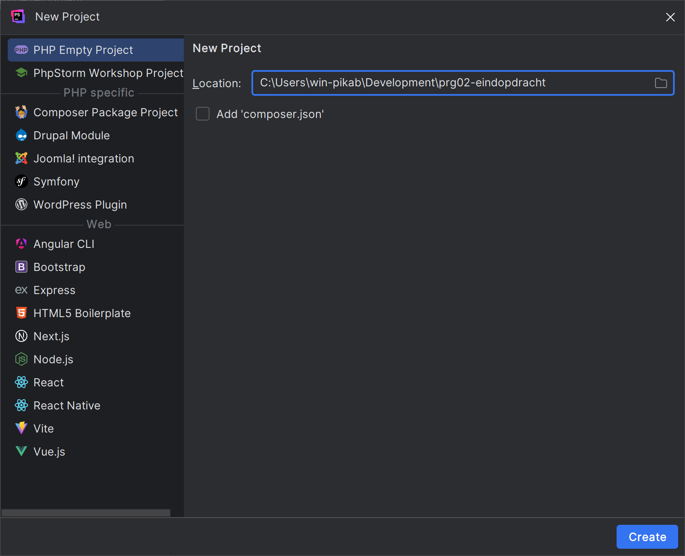

# Installatiestappen webserver en IDE

# Inhoud

- [Download](#download)
- [Jetbrains Account](#jetbrains-account)
- [Installatie](#installatie)
    - [Git](#git)
    - [Development map aanmaken](#development-map-aanmaken)
    - [Laravel Herd](#laravel-herd)
        - [Installatie Herd](#installatie-herd)
        - [Configuratie Herd](#configuratie-herd)
    - [Jetbrains Toolbox](#jetbrains-toolbox)
    - [PhpStorm](#phpstorm)
        - [Installatie PhpStorm](#installatie-phpstorm)
        - [Configuratie PhpStorm](#configuratie-phpstorm)
        - [AI assistant](#ai-assistant)
    - [Server testen](#server-testen)
    - [DBngin](#dbngin)
        - [Databaseserver toevoegen](#databaseserver-toevoegen)
        - [phpMyAdmin toevoegen](#phpmyadmin-toevoegen)
    - [Checklist](#checklist)
- [PHP Projecten](#php-projecten)
    - [Lesopdrachten](#lesopdrachten)
    - [Werkmap](#werkmap)
    - [Eindopdracht](#eindopdracht)
        - [Toevoegen aan GitHub](#toevoegen-aan-github)
- [[OPTIONEEL] GitHub Student Developer Pack](#optioneel-github-student-developer-pack)
    - [Domeinnaam](#domeinnaam)

--------------------

# Download

Download de volgende pakketten maar installeer deze nog **NIET**. De installatie volgt stap voor stap in deze
handleiding.

- Download [Laravel Herd](https://herd.laravel.com/) (de Pro versie is niet nodig)
- Download en installeer de [Jetbrains Toolbox](https://www.jetbrains.com/toolbox-app/)
- Download [DBngin](https://dbngin.com/)
- Download [Git](https://git-scm.com/downloads) (Gebruik je een Mac? [Lees dan eerst het hoofdstuk hierover.](#git))

--------------------

# Jetbrains Account

Jetbrains biedt studenten de mogelijkheid, zolang je studeert, om gratis gebruik te maken
van hun software. Hiervoor moet je een account aanmaken op de
[Jetbrains website](https://www.jetbrains.com/shop/eform/students). Gebruik hiervoor je e-mailadres
van de Hogeschool Rotterdam.

--------------------

# Installatie

## Git

**Mac**

1. De meeste Macs hebben Git al geïnstalleerd. Open **Terminal** en typ `git --version`.
2. Zie je een versienummer? Dan is Git al geïnstalleerd en kun je deze stap overslaan.
3. Zo niet, dan kun je Git installeren via de [Git-website](https://git-scm.com/download/mac). We raden de
   Homebrew-optie aan. Die heb je op de Mac later ook nog nodig.

**Windows**

1. Dubbelklik de installer en volg de stappen. Laat alle instellingen staan zoals ze staan, behalve de onderstaande.
2. Bij **Select components** vink je de optie **Add a Git Bash Profile to Windows Terminal** aan.

   

3. Bij het scherm **Adjusting the name of the initial branch in new repositories** kies je voor **main**.

   

## Development map aanmaken

In deze stap ga je een **Development** map aanmaken waar alle PHP-projecten in komen te staan. Elke map die je
in de Development map aanmaakt, wordt automatisch toegevoegd aan de webserver als site. Deze is dan te openen
in de browser via de naam van de map met `.test` erachter.

> ⚠️ **Let op:** kies een locatie op je harde schijf die **buiten** je OneDrive of Google Drive map ligt. Deze mappen
> synchroniseren met de cloud, wat vervelend kan zijn als het om veel bestanden gaat. Ook kan het problemen geven met
> de rechten van de bestanden. Om toch een backup te hebben van de projecten is het verstandig deze toe te voegen aan
> Git en te uploaden naar GitHub.

1. Kies een locatie op je harde schijf die buiten je OneDrive of Google Drive map ligt.
2. Maak de Development map aan:
    - **Windows**: `C:\Users\[USER ACCOUNT]\Development`
    - **Mac**: `~/Development` of `Users/[USER ACCOUNT]/Development`

## Laravel Herd

### Installatie Herd

1. Start en doorloop de installer van [Laravel Herd](https://herd.laravel.com/).
2. Vink **Launch at login** aan.
3. **Mac**: geef toestemming voor de Helper Service.
4. Let op bij **Enable Herd Studio**: vink dit **uit**.
5. Bij Herd Pro kies je voor **Skip for now**.

Zoals aangegeven op het laatste scherm, zullen alle PHP-projecten standaard in de browser te zien zijn door de naam van
de folder te schrijven met erachter `.test`. Standaard moet je daarvoor de projecten in de `~/Herd` folder zetten. Wij
gebruiken hiervoor de Development folder.

Bekijk daarom de instellingen van Herd:

1. Open het Herd dashboard door op het Herd-icoon te klikken:
    - **Windows**: in de system tray (rechtsonderin).
    - **Mac**: in de menu bar (rechtsboven).
2. Klik op **Settings**.
3. Onder **General** zie je **Herd Paths** staan. Voeg hieraan de Development folder toe die je zojuist hebt aangemaakt.
4. Via de optie **Applications** (in Settings) kun je je projecten openen.

### Configuratie Herd

#### Trailing slash toevoegen

Om ervoor te zorgen dat de URL's in de browser altijd eindigen met een `/` moet je de volgende stappen doorlopen in Herd:

1. Klik met de rechtermuisknop op het Herd-icoon in de system tray (Windows) of menu bar (Mac).
2. Kies voor **Configuration files**.
3. Dit opent `.config/herd`.
    - **Mac**: dit opent de map `php`; ga nu één map omhoog.
4. Ga naar `config/nginx` en open `herd.conf` in een teksteditor.
5. Voeg boven het onderdeel `location` de volgende regel toe:
   ```apacheconf
   rewrite ^([^.]*[^/])$ $1/ permanent;
   ```
6. Nu ziet je configuratie er als volgt uit:
   ```apacheconf
   server {
       listen 127.0.0.1:80 default_server;
       #listen VALET_LOOPBACK:80; # valet loopback
       root /;
       charset utf-8;
       client_max_body_size 128M;

       rewrite ^([^.]*[^/])$ $1/ permanent;

       location ~* /41c270e4-5535-4daa-b23e-c269744c2f45/([A-Z]+:)(.*) {
           internal;
           alias $1;
           try_files $2 $2/;
       }
   ```
7. Sla het bestand op en sluit het.
8. Klik opnieuw met de rechtermuisknop op het Herd-icoon in de system tray (Windows) of menu bar (Mac) en kies voor
   **Stop all services** en vervolgens **Start all services**.

#### Directory listing aanzetten

Om straks makkelijk naar bestanden te kunnen navigeren in de browser zetten we **directory listing** aan. Vanwege
veiligheidsoverwegingen staat **directory listing** standaard uit.

1. Open **PowerShell** (Windows) of **Terminal** (Mac).
2. Voer het volgende commando uit:
   ```bash
   herd directory-listing on
   ```

> ℹ️ **Mac:** het kan zijn dat je deze opdracht op de Mac 2x moet uitvoeren om het resultaat te zien.

## Jetbrains Toolbox

1. Dubbelklik de installer en volg de stappen.
2. Als de Jetbrains Toolbox helemaal geïnstalleerd is, kun je inloggen met je Jetbrains account.
   Open de toolbox, klik op het icoontje rechtsboven in de hoek en klik op **Log in**.

   

3. Via de browser kun je nu inloggen met het Jetbrains Account dat je zojuist hebt aangemaakt.

## PhpStorm

### Installatie PhpStorm

1. Open de Jetbrains Toolbox (system tray) en zoek naar PhpStorm.
2. Klik op **Install** en wacht tot de installatie is voltooid.
3. Open PhpStorm vanuit de toolbox.
4. Geef toestemming voor netwerken.
5. Je kunt Jetbrains eventueel helpen door anonieme statistieken te delen.

### Configuratie PhpStorm

Als je in PhpStorm werkt, zitten er enorm veel handige features, snelkoppelingen, enzovoort in waar we ook regelmatig bij stilstaan.
Er zijn echter ook drie instellingen die standaard niet ideaal ingesteld zijn. We raden je aan deze als volgt aan te passen:

**1. Zet de inline completion uit** (in de instellingen)

Daarmee voorkom je automatische suggesties die, net als een AI-agent, je op dit moment in je opleiding eerder tegenwerken dan helpen. Het nu zelf leren en later deze feature aanzetten is uiteraard een logische vervolgstap. Maar fouten krijgen na autocompletion, zonder dat je nog goed weet wat de code doet, werkt jezelf alleen maar tegen.

1. Ga naar **Settings**:
    - **Windows**: File > Settings
    - **Mac**: PhpStorm > Settings
2. Zoek in de zoekbalk op `inline completions`.
3. Zet **Enable inline completions using language models** uit.

   

**2. Zet de commit tool aan** (in de instellingen)

Daarmee krijg je, als je gaat committen, een popup waar je beter overzicht hebt over wat je gaat committen.

1. Zoek in de instellingen op `commit tool`.
2. Ga naar **Advanced Settings** en zet de optie **Enable commit tool** aan.

   

**3. Zet het vinkje "clear initial message" aan** (in de instellingen)

Hiermee wordt je altijd geforceerd om een nieuw bericht te typen voordat je commit.


**Tips**

> **Tip 1: code automatisch formatteren.** We zien nog regelmatig niet netjes geformatteerde code voorbijkomen. Als je
> zoekende bent in code, kan dit je tegenwerken. Door het vinkje **Reformat code** aan te zetten bij **Actions on save**
> wordt je code bij het opslaan automatisch geformatteerd en weer netjes uitgelijnd. Lang leve leesbaarheid!


> **Tip 2: minder warnings bij een commit.** ⚠️ **Dit is een tip en kun je nu niet direct aanpassen!** Wanneer je een
> commit doet, kun je in de popup ook gemakkelijk de vinkjes voor **Analyze code** en **Check TODO** uitzetten,
> waardoor je geen ellenlange warnings krijgt bij een commit.


### AI assistant

Wanneer je vragen wilt stellen aan AI doe je dat in de **Ask mode**. Wanneer je de agent gebruikt, worden de denkstappen voor je gedaan. Dat zit je eigen ontwikkeling in de weg.

Als je een vraag wilt stellen, dan kun je dit het beste in Copilot doen. Daar heb je een keuze uit modellen en zit je niet vast aan het freemium model dat de Jetbrains AI assistant standaard biedt.

**Jetbrains AI Assistant uitzetten**

1. Ga naar de instellingen van PhpStorm en klik op **Plugins**.
2. Zoek in de zoekbalk op **Air**.
3. Zet de schakelaar uit.

**Github Copilot aanzetten**

1. Ga naar de instellingen van PhpStorm en klik op **Plugins**.
2. Zoek in de zoekbalk op **Github Copilot**.
3. Klik op **Enable**.
4. Je zal hierna PhpStorm moeten herstarten.

   

**Autocomplete uitzetten**

1. Onderaan in PhpStorm zie je nu een Copilot-icoon.
2. Klik hierop en kies voor de optie **Disable Completions**.

   

## Server testen

Om te testen of de server werkt voegen we een `serverinfo` map toe aan de Development map. Hierin komt een
bestand `phpinfo.php` te staan. Dit bestand geeft informatie over de PHP-instellingen van de server.

1. Open de **Development** map in Explorer/Finder (bijvoorbeeld `C:\Users\[USER ACCOUNT]\Development`) en voeg de
   map `serverinfo` toe.
2. Open PhpStorm en open de map `serverinfo`.
3. Kies voor **Trust Project** (en vink aan dat je voortaan alle projecten in de Development map vertrouwt).
4. Aan de linkerkant zie je een icoontje van een map om de mappenstructuur te zien. Klik hierop als deze nog niet
   zichtbaar is.
5. Klik met de rechtermuisknop op de hoofdmap `serverinfo` en kies voor **New > PHP File**.
6. Geef het bestand de naam `phpinfo.php`.
7. Typ in dit bestand:
   ```php
   <?php
   phpinfo();
   ```

Dit bestand ga je nu in de browser bezoeken:

1. Klik met de rechtermuisknop op **Herd** in de system tray en kies voor **Applications**.
2. Waarschijnlijk moet je eerst op verversen klikken om de site te zien. Klik hiervoor op het icoontje met het pijltje.
3. Je ziet nu de site `serverinfo.test` staan. Klik hierop. De details van de site worden getoond (rechts).
4. Zorg ervoor dat je sites altijd HTTPS zijn. Vink dit aan in de opties.

   > ⚠️ **Let op:** dit moet je doen, anders werkt de link in de volgende stap niet zoals bedoeld.

5. In de gegevens zie je een URL staan, met de link naar de site:
   [https://serverinfo.test](https://serverinfo.test). Klik hierop.
6. Je ziet nu de volgende pagina. Klik op de link naar het bestand `phpinfo.php`.

   > **Index of /**
   >
   > [/phpinfo.php](https://serverinfo.test/phpinfo.php)

7. Je ziet nu een pagina met informatie over de PHP-instellingen van de server.

🎉 Gefeliciteerd! Je hebt nu een werkende webserver en IDE.

> ⚠️ **Let op:** wanneer je het bestand (`phpinfo.php`) gebruikt op een live-server om informatie over de server te
> krijgen, is het verstandig om het bestand, na het inzien van de informatie, direct te verwijderen. Het geeft namelijk
> veel informatie over de server en kan een veiligheidsrisico vormen.

## DBngin

1. Dubbelklik de installer en volg de stappen. Laat de standaard opties staan.
2. Na het starten van de applicatie vink je bovenin de twee opties aan:
    - **Start on login**
    - **Show in taskbar**

### Databaseserver toevoegen

Als eerste gaan we een nieuwe MySQL server toevoegen, om vervolgens een database aan te kunnen maken.

1. Klik op het `+`-teken om een database toe te voegen en kies voor **MySQL**.

   

2. In het volgende overzicht pas je het volgende aan:
    - **Version**: 8.4
    - **Name**: MySQL
    - Vinkje voor **Automatically start service on Login**.

   

   > ⚠️ **Let op:** zoals aangegeven in de afbeelding (oranje letters), zijn de default credentials om te verbinden met
   > de server:
   > - **Username**: `root`
   > - **Password**: _leeg laten_

3. Klik op **Create** en vervolgens op **OK** om een admin toe te voegen.
4. Geef toestemming voor de toegang tot netwerken.
5. De server is nu toegevoegd aan het beginscherm van DBngin. Klik op **Start** om de server te starten. In de
   toekomst zal na een herstart van de computer de server automatisch starten.

   

### phpMyAdmin toevoegen

Om makkelijk bij een database te kunnen, om bijvoorbeeld een nieuwe database aan te maken, de inhoud van een tabel te
kunnen zien of om data te bewerken (admin taak) kun je gebruik maken van een database management tool. Deze bestaan in
desktop variant, het zit ook ingebouwd in PhpStorm, maar een veelgebruikte variant is via een webomgeving. phpMyAdmin
is een veelgebruikte toepassing. Om phpMyAdmin te kunnen gebruiken doe je het volgende:

1. Download [phpMyAdmin](https://www.phpmyadmin.net/downloads/). Je kunt de ZIP-file van de Engelse versie downloaden.
2. Open de `Development` map in de Finder/Explorer en sleep de ZIP-file naar deze map.
3. Pak de ZIP-file uit en hernoem de map naar `phpmyadmin`.
4. In de map `phpmyadmin` staat een bestand `config.sample.inc.php`. Hernoem dit bestand naar `config.inc.php`.
5. Open het bestand in een teksteditor en zoek naar de regel `$cfg['Servers'][$i]['AllowNoPassword']`.
   Verander de waarde van `false` naar `true`.
6. Verander ook de host naar `127.0.0.1`:
   ```php
   $cfg['Servers'][$i]['host'] = '127.0.0.1';
   ...
   $cfg['Servers'][$i]['AllowNoPassword'] = true;
   ```
7. Sla het bestand op en sluit het.
8. Via de browser kun je nu phpMyAdmin openen door naar `phpmyadmin.test` te gaan.
   Of via de Sites in Herd (wel even verversen).

## Checklist

Controleer of alles werkt voordat je verder gaat:

- [ ] Git is geïnstalleerd (`git --version` geeft een versienummer).
- [ ] De Development map bestaat en is toegevoegd aan Herd Paths.
- [ ] Herd draait en directory listing staat aan.
- [ ] PhpStorm is geïnstalleerd en de instellingen zijn aangepast.
- [ ] `serverinfo.test` toont de PHP-informatie van `phpinfo.php`.
- [ ] DBngin draait met een MySQL server (versie 8.4).
- [ ] `phpmyadmin.test` opent phpMyAdmin.

--------------------

# PHP Projecten

In de **Development** map gaan we drie projecten maken. Het eerste project komt van GitHub en dat is het project met
alle **lesopdrachten** en voorbeelden. Het tweede project is de **werkmap** waarin je alle lesopdrachten
uitwerkt. Het laatste project is het project met de **eindopdracht**. Hierin komt de website te staan die je deze cursus
gaat maken en die je aan het einde van de cursus inlevert als eindopdracht.

Dit zijn losse projecten die je ook los opent in PhpStorm. Je hebt straks dus drie projecten openstaan in PhpStorm in
drie verschillende vensters.

## Lesopdrachten

1. Ga naar de [GitHubpagina](https://GitHub.com/HR-CMGT) van CMGT en dan specifiek de [repository
   van Programmeren 2](https://GitHub.com/HR-CMGT/PRG02-2026-2027).
2. Hier zie je een groene knop met de tekst **Code**. Klik hierop en kopieer de `https` link die je ziet staan.
3. Ga nu naar PhpStorm en kies voor **Clone Repository**.

   

4. Plak de link van GitHub bij **URL** en bij **Directory** navigeer je naar de **Development** map.
5. Achter **Development** geef je de map de naam `prg02-lesopdrachten` en klik je op **Clone**.

   

6. Log in met GitHub via de browser.
7. Wil je de PHP-bestanden inzien, dan open je de map `prg02-lesopdrachten` in PhpStorm.
8. Je kunt het resultaat ook bekijken in de browser. Open en ververs de Sites in Herd en klik op de
   site `prg02-lesopdrachten.test`. Je kunt natuurlijk ook direct naar `prg02-lesopdrachten.test` in de browser gaan.

## Werkmap

1. Maak een nieuwe map aan in de **Development** map en noem deze `prg02-werkmap`.
2. Wanneer je aan de lesopdrachten gaat werken, kopieer je de map van de les naar deze map.
   Zo kun je de lesopdrachten uitwerken zonder dat je de originele lesopdrachten aanpast.
3. In PhpStorm ga je naar **File > Open** en navigeer je naar de map `prg02-werkmap`.
4. Open het project in een **nieuw venster**.

## Eindopdracht

1. Ga in PhpStorm naar **File > New Project**.
2. Kies voor **Empty PHP Project**.
3. Geef de map de naam `prg02-eindopdracht`.
4. Plaats deze in de **Development** map.

   

5. Klik op **Create**. Je ziet nu een lege map met de naam `prg02-eindopdracht`.

Maak nu een `.gitignore` bestand aan zodat je bepaalde onderdelen kunt uitsluiten. De onderdelen die in `.gitignore` staan, worden **niet** naar GitHub gestuurd.

1. Maak een nieuw bestand aan. Klik hiervoor met de rechtermuisknop op de naam (`prg02-eindopdracht`) en kies voor **New > File**.
2. Noem dit bestand `.gitignore`.
3. Typ in het bestand `.idea` en sla het op.

### Toevoegen aan GitHub

Om ervoor te zorgen dat jouw project veilig is opgeslagen, voeg je deze toe aan GitHub. Doe dit voor het project
met de eindopdracht. Je kunt dit ook doen voor de werkmap.

1. Als het project open staat, klik je op **VCS > Share Project on GitHub**.
2. Eventueel moet je hierna inloggen met je GitHub account.
3. Klik op **Share** en je project wordt geüpload naar GitHub.

--------------------

# [OPTIONEEL] GitHub Student Developer Pack

Als onderdeel van de GitHub Student Pack heb je toegang tot allerlei gratis diensten, waaronder een gratis
account op GitHub Pro. Hiermee kun je onbeperkt private repositories aanmaken, toegang tot cursussen, een jaar lang gratis domeinnaamregistratie bij Namecheap en nog veel meer.

1. Om toegang te krijgen tot deze diensten, ga je naar [https://education.GitHub.com/pack](https://education.GitHub.com/pack).
2. Klik op **Get student benefits**.
3. Kies voor **Student**.
4. Gebruik het e-mailadres van de Hogeschool Rotterdam als je het account aanmaakt.

## Domeinnaam

Via het student pack kun je bij Namecheap een domeinnaam (.me) registreren.

- [Registreren via de educatieve promotie van Namecheap](https://www.namecheap.com/support/knowledgebase/article.aspx/9687/35/how-to-register-a-domain-via-our-educational-promotion-at-ncme/)
